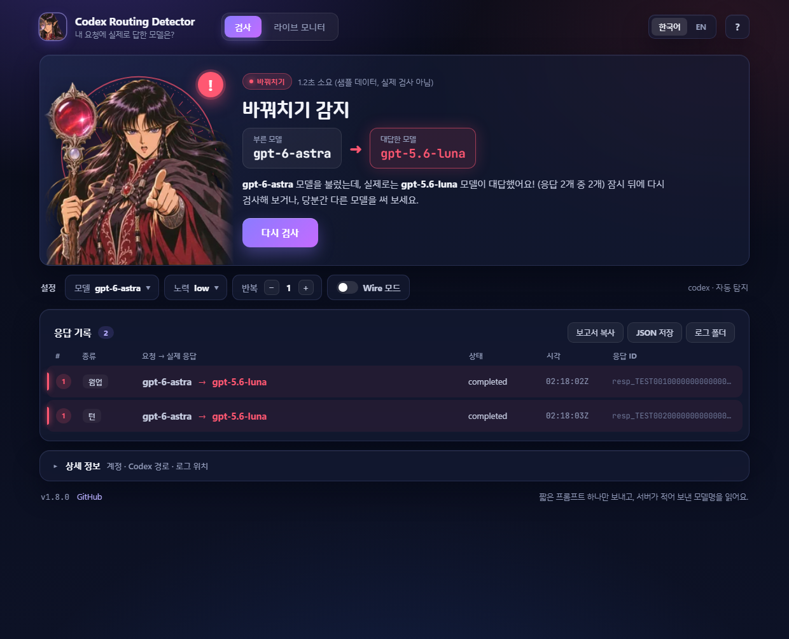
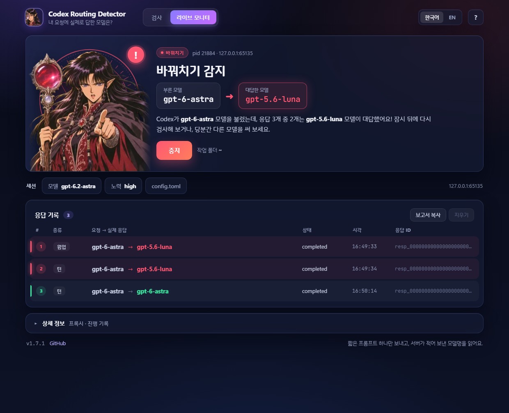

<p align="center">
  <picture>
    <source media="(prefers-reduced-motion: reduce)" srcset="docs/mascot.png">
    
  </picture>
</p>

<h1 align="center">Codex Routing Detector</h1>

<p align="center">
  <b><code>gpt-6.2-astra</code>를 불렀는데… 정말 그 모델이 대답했을까요? 🔮</b><br>
  <sub>마도사가 렌즈로 들여다보고 진짜 대답한 모델을 알려 주는 작은 Windows 앱이에요.</sub>
</p>

<p align="center">
  <a href="https://github.com/darkdarkcocoa/codex-routing-detector/releases/latest"></a>
  
  
  <a href="LICENSE"></a>
</p>

<p align="center">
  <a href="https://github.com/darkdarkcocoa/codex-routing-detector/releases/latest"><b>⬇️ 다운로드</b></a> ·
  <a href="README.md">🇺🇸 English</a> ·
  <a href="#faq">💬 자주 묻는 질문</a>
</p>



## ✨ 이런 걸 해요

Codex는 언제나 내가 고른 모델을 쓰고 있다고 *말해요*. 이 앱은 그 말 대신 **서버**에게 직접
물어보고, 어떤 모델을 불렀고 실제로는 누가 대답했는지 한 문장으로 알려 드려요.

| | | |
|:-:|---|---|
|  | **정상** 💚 | 고른 모델이 직접 대답했어요. |
|  | **바꿔치기** ❤️‍🔥 | 다른 모델이 대답했어요. 예: `gpt-6-astra → gpt-5.6-luna` |
|  | **확인 필요** 💛 | 요금제에 없는 모델이거나 서버가 바빴어요. 조금 뒤에 다시 해 보세요. |

- 🔍 **검사**: 버튼 한 번, 30초쯤 기다리면 답이 나와요.
- 👀 **라이브 모니터**: 내가 Codex CLI로 작업하는 동안 응답 하나하나를 옆에서 지켜봐요. 추가 비용은 없어요.
- 🔒 **내 컴퓨터에만 남아요**: 프롬프트와 답변은 저장하지 않고, 밖으로 나가는 건 새 버전 확인 한 번뿐이에요.

## 📦 설치

- **Windows**: [Releases](https://github.com/darkdarkcocoa/codex-routing-detector/releases/latest)에서
  `codex-routing-detector.exe`를 받아 더블클릭하면 끝이에요. 처음 한 번 SmartScreen이 인사할 수
  있어요(*추가 정보 → 실행*). 새 버전이 나오면 알아서 업데이트돼요.
- **Python 3.8 이상**:
  ```
  pipx install git+https://github.com/darkdarkcocoa/codex-routing-detector
  pipx inject codex-routing-detector pywebview
  codex-routing-detector-gui
  ```

ChatGPT로 로그인된 Codex(CLI나 Desktop)만 있으면 돼요. 라이브 모니터는 CLI가 필요해요.

## 🚀 이렇게 써요

1. 앱을 열어요. `~/.codex/config.toml`에 적힌 모델이 이미 골라져 있어요.
2. **검사하기**를 누르고 30초쯤 기다려요.
3. 카드를 봐요. **부른 모델** 옆에 **대답한 모델**이 나란히 떠요. 🎉

작업하면서 계속 지켜보고 싶다면 **라이브 모니터** 탭에서 **모니터링 시작**을 누르세요. Codex 창이
열리고, 응답이 올 때마다 한 줄씩 쌓여요.



> 💡 대화를 시작할 때 보이는 작은 모델 줄(`gpt-5.6-luna → gpt-5.6-luna` 같은)은 Codex가 대화
> 제목을 짓는 거예요. **내 모델 → 다른 모델**일 때만 바꿔치기예요.

## 💭 왜 만들었냐면요

2026년 9월, `gpt-6-astra`가 갑자기 하위 모델처럼 느껴졌어요. 요청에는 `gpt-6-astra`라고 적혀
있는데 서버가 돌려준 응답에는 `gpt-5.6-luna`라고 적혀 있었고, Codex에는 아무 알림도 없었어요. 😿
Codex 화면과 로그에는 **요청한** 모델만 남아서, 이 앱은 서버가 실제로 실행했다고 적어 보낸 모델을
읽어요.

<a name="faq"></a>

## 💬 자주 묻는 질문

<details>
<summary><b>이거 쓰다가 계정이 제재받지 않나요?</b></summary>

평소 Codex를 쓸 때와 다른 일은 하지 않아요. 검사는 내 Codex CLI로
`Reply with exactly the single word: pong` 한 마디를 보내는 거라, 서버 입장에서는 내가 직접 입력한
것과 똑같아요. 라이브 모니터는 따로 요청을 보내지 않고, 회사 프록시용으로 Codex가 공식 지원하는
방식([`CODEX_CA_CERTIFICATE`](https://developers.openai.com/codex/auth))으로 통신을 한 바이트도
바꾸지 않고 전달만 해요. 위험이 아예 없다고 장담할 수는 없으니, 검사를 쉬지 않고 연달아 돌리지만
말아 주세요.
</details>

<details>
<summary><b>검사 한 번에 얼마나 드나요?</b></summary>

작은 요청 두 개(Codex의 워밍업 + 대화 한 번)예요. 각각 시스템 프롬프트로 입력 토큰 1만 2천~1만
6천 개쯤, 답은 몇 토큰이에요. 다른 Codex 대화처럼 사용량에 잡혀요. 라이브 모니터는 추가 비용이
없어요.
</details>

<details>
<summary><b>뭘 저장하고, 인터넷에 따로 접속하나요?</b></summary>

검사는 서버가 보낸 원본 메시지만 개인 임시 폴더에 남겨요(**로그 폴더**로 열 수 있어요). 내 요청,
인증 헤더, 쿠키는 저장하지 않아요. 라이브 모니터는 모델 이름, ID, 상태, 시각만 메모리에 둬요.
시작할 때 `api.github.com`에 새 버전이 있는지 한 번 물어보고, exe는 SHA-256을 확인한 뒤 스스로
업데이트해요(`--no-update-check`로 끌 수 있어요). 폰트와 그림은 프로그램 안에 들어 있어요.
</details>

<details>
<summary><b>바꿔치기가 떴어요. 뭘 제보하면 되나요?</b></summary>

**보고서 복사**를 누르세요. 응답 ID, 시각(UTC), 요청/응답 모델, 요금제와 사용량, Codex 버전이 한
번에 담겨요. 📮
</details>

<details>
<summary><b><code>openai/gpt-6-astra</code>가 왜 <code>gpt-6-astra</code>로 바뀌나요?</b></summary>

Codex 모델 이름에는 `openai/` 같은 앞머리가 없고, 서버도 앞머리 붙은 이름은 거절해요. 그래서
앞머리를 떼고 검사한 뒤 **상세 정보**에 적어 둬요.
</details>

## 🧰 더 궁금하다면

<details>
<summary><b>창의 설정들</b></summary>

- **모델**: Codex의 모델 카탈로그에서 가져와요. 목록에 없으면 *직접 입력...*으로 적어요.
- **노력**: 고른 모델이 지원하는 단계만 보여요(`ultra`는 검사에 너무 비싸서 뺐어요).
- **반복**: 1~10번. 바꿔치기가 계속되는지, 왔다 갔다 하는지 볼 때 좋아요.
- **Wire 모드**: 같은 판정을 mitmproxy로 Codex 바깥에서 기록해요(`pip install mitmproxy`).
- **웜업 / 턴**: Codex는 세션마다 요청을 두 번 보내요. 둘 중 하나라도 다른 모델이 대답하면 바꿔치기예요.
- **보고서 복사 / JSON 저장 / 로그 폴더**: 증거를 글, JSON, 서버 원본 메시지로 챙겨요.
</details>

<details>
<summary><b>명령줄</b></summary>

```
codex-routing-detector                        # config.toml의 모델 + 대조군 모델
codex-routing-detector -m gpt-6-astra         # 특정 모델만
codex-routing-detector -r 3                   # 검사마다 3번씩
codex-routing-detector --json out.json --full-ids
codex-routing-detector --wire                 # mitmproxy로 패킷 수준 기록
codex-routing-detector --live                 # 새 창에서 Codex CLI 세션 지켜보기
```

종료 코드: `0` 모두 요청한 모델이 대답, `2` 하나라도 다른 모델이 대답, `1` 검사할 수 없었거나
사용법 오류.

| 옵션 | 뜻 |
|---|---|
| `-m/--model MODEL` | 검사할 모델(여러 번 지정 가능). 기본값: `~/.codex/config.toml`의 `model`, 없으면 `gpt-6.2-astra` |
| `--control MODEL` / `--no-control` | 함께 검사할 대조군 모델(기본 `gpt-5.6-sol`). 대조군은 정상인데 내 모델만 다르면 내 모델만 바꿔치기된 거예요 |
| `-e/--effort LEVEL` | 검사에 쓸 `model_reasoning_effort`. 기본 `low` |
| `-t/--tier TIER` | `service_tier` 지정 |
| `-r/--repeat N` | 검사마다 N번 |
| `--prompt TEXT` | 검사에 보낼 프롬프트 |
| `--timeout SEC` | 검사 하나의 제한 시간(기본 240초) |
| `--codex PATH` | codex 실행 파일(`CODEX_BIN`도 돼요) |
| `--wire` | 추적 로그 대신 mitmproxy 사용 |
| `--live` / `--live-dir DIR` | 실제 Codex CLI 세션 지켜보기. `--` 뒤의 인자는 codex로 넘어가요 |
| `--json FILE` / `--out DIR` / `--full-ids` | 보고서, 원본 로그 폴더, ID 전체 출력 |
| `--no-update-check` / `--no-auto-update` | 새 버전 확인 안 함 / exe를 바꾸지 않음 |
| `--version` | 버전 출력 |
</details>

<details>
<summary><b>판정 종류</b></summary>

- `REROUTED`: 서버의 응답 객체에 요청과 다른 모델이 적혀 있어요(같은 모델의 날짜 붙은 스냅샷은 인정하고 적어 둬요).
- `ok`: 요청한 모델이 대답했고 턴도 끝까지 완료됐어요.
- `UNSUPPORTED`: 이 계정에서 쓸 수 없는 모델이라 서버가 거절했어요.
- `ERROR`: 서버가 `server_is_overloaded`("at capacity") 같은 오류로 답했어요.
- `UNKNOWN`: 모델을 확인할 수 없었어요(`model` 필드가 없거나 턴이 끝나지 않았어요).
- `NO_DATA`: WebSocket 메시지가 하나도 없었어요(로그인 안 됨, API 키 모드, 네트워크 없음, 다른 `model_provider`).
</details>

<details>
<summary><b>어떻게 동작하나요</b></summary>

**검사**는 진짜 `codex exec`를
`RUST_LOG=tungstenite::protocol=trace,tungstenite::protocol::frame=off`로 실행해요. 그러면 Codex
안의 WebSocket 라이브러리가 서버 메시지를 그대로 로그에 남기고, 앱은
`response.created` / `response.completed`의 `response.model`을 읽어요. 검사마다 새 세션을 읽기
전용으로 열어요.

**Wire 모드**는 일회용 인증서를 `CODEX_CA_CERTIFICATE`로 넘겨서 mitmproxy를 Codex 앞에 둬요.
시스템에는 아무것도 설치하지 않아요.

**라이브 모니터**는 같은 일을 127.0.0.1의 내장 CONNECT 프록시와 세션 전용 인증서로 해요. 모든
바이트를 그대로 전달하고, 응답 WebSocket만 풀어서 읽어요.
</details>

<details>
<summary><b>앱 없이 직접 확인하기</b></summary>

PowerShell:

```
$env:RUST_LOG = 'tungstenite::protocol=trace,tungstenite::protocol::frame=off'
codex exec --ephemeral -s read-only --skip-git-repo-check -c model=gpt-6-astra "Reply with exactly the single word: pong" 2>&1 |
  Select-String -Pattern '"type":"response.completed".*?"model":"([^"]+)"' | ForEach-Object { $_.Matches[0].Groups[1].Value }
Remove-Item Env:RUST_LOG
```

bash / Git Bash:

```
RUST_LOG='tungstenite::protocol=trace,tungstenite::protocol::frame=off' codex exec --ephemeral -s read-only --skip-git-repo-check \
  -c model=gpt-6-astra "Reply with exactly the single word: pong" 2>&1 </dev/null \
  | grep -o '"type":"response.completed","response":{"id":"[^"]*"[^}]*"model":"[^"]*"' | grep -o '"model":"[^"]*"'
```

워밍업과 턴에서 실제로 대답한 모델이 한 번씩 출력돼요.
</details>

## 💜 만든 것들

- 하프엘프 마도사는 Codex CLI의 이미지 생성으로 그렸고,
  [`tools/make_idle_loop.py`](tools/make_idle_loop.py)로 움직이게 했어요. 자세한 건 [`art/`](art/README.md)에 있어요.
- 폰트: 나눔스퀘어라운드, JetBrains Mono, Fredoka. 모두 SIL 오픈 폰트 라이선스 1.1이에요([저작권 안내](docs/FONT-LICENSES.txt)).
- 빌드, 테스트, 디자인 메모: [`docs/DEVELOPMENT.md`](docs/DEVELOPMENT.md)
- [MIT 라이선스](LICENSE)

<p align="center"><sub>내 모델이 언제나 이름 그대로의 모델이기를. 🔮✨</sub></p>
