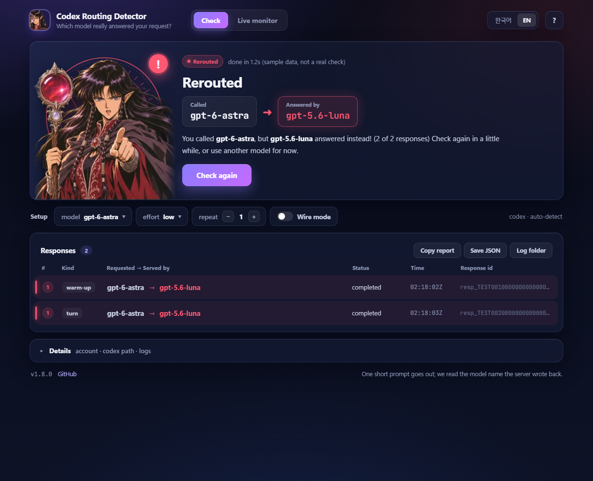
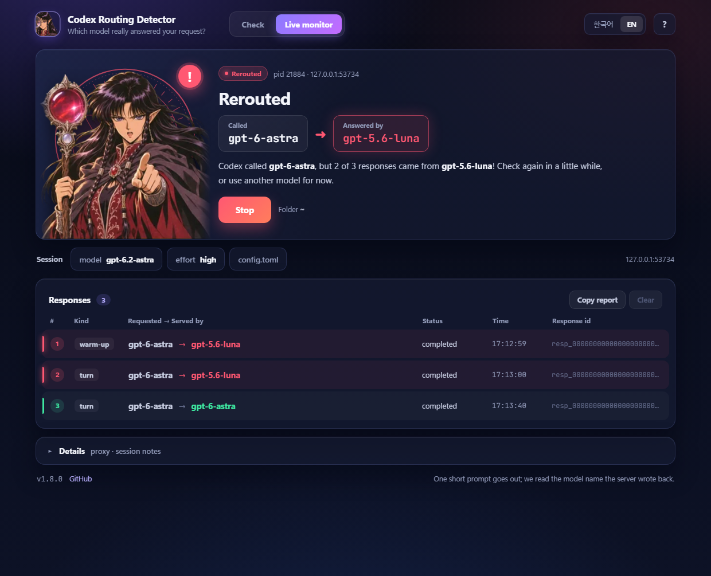

<p align="center">
  <picture>
    <source media="(prefers-reduced-motion: reduce)" srcset="docs/mascot.png">
    
  </picture>
</p>

<h1 align="center">Codex Routing Detector</h1>

<p align="center">
  <b>You called <code>gpt-6.2-astra</code>… but who actually answered? 🔮</b><br>
  <sub>A tiny Windows app whose seer peeks through her lens and tells you the truth.</sub>
</p>

<p align="center">
  <a href="https://github.com/darkdarkcocoa/codex-routing-detector/releases/latest"></a>
  
  
  <a href="LICENSE"></a>
</p>

<p align="center">
  <a href="https://github.com/darkdarkcocoa/codex-routing-detector/releases/latest"><b>⬇️ Download</b></a> ·
  <a href="README.ko.md">🇰🇷 한국어</a> ·
  <a href="#faq">💬 FAQ</a>
</p>



## ✨ What it does

Codex always *says* it's using the model you picked. This app asks the **server** instead, and
shows you in one friendly sentence which model you called and which one really replied.

| | | |
|:-:|---|---|
|  | **All good** 💚 | The model you picked answered. |
|  | **Rerouted** ❤️‍🔥 | Someone else answered, e.g. `gpt-6-astra → gpt-5.6-luna`. |
|  | **Needs a look** 💛 | Your plan lacks that model, or the server was busy. Try again in a bit. |

- 🔍 **Check**: one button, about 30 seconds, one clear answer.
- 👀 **Live monitor**: watches your own Codex CLI session as you work, reply by reply, at no extra cost.
- 🔒 **Stays on your computer**: no prompts or answers are saved, and the only outside call is a
  release check.

## 📦 Install

- **Windows**: grab `codex-routing-detector.exe` from
  [Releases](https://github.com/darkdarkcocoa/codex-routing-detector/releases/latest) and
  double-click. (SmartScreen may say hi once: *More info → Run anyway*.) It updates itself.
- **Python 3.8+**:
  ```
  pipx install git+https://github.com/darkdarkcocoa/codex-routing-detector
  pipx inject codex-routing-detector pywebview
  codex-routing-detector-gui
  ```

You just need Codex (CLI or Desktop) signed in with ChatGPT. The live monitor needs the CLI.

## 🚀 How to use

1. Open the app. It already knows your model from `~/.codex/config.toml`.
2. Press **Check** and wait about half a minute.
3. Read the card: the model you **called** sits next to the model that **answered**. 🎉

Want to keep watching while you work? Open **Live monitor** and press **Start monitoring**. A
Codex window opens, and every reply shows up as a new line.



> 💡 A small-model line right at the start (like `gpt-5.6-luna → gpt-5.6-luna`) is just Codex
> naming your conversation. Only *your model → another model* is a reroute.

## 💭 Why it exists

In September 2026, `gpt-6-astra` suddenly felt smaller. The request said `gpt-6-astra`, but the
server's own reply said `gpt-5.6-luna`, with no notice anywhere in Codex. 😿 Codex's window and logs
only show the model you *asked for*, so this app reads the one the server says actually ran.

<a name="faq"></a>

## 💬 FAQ

<details>
<summary><b>Can this get my account flagged?</b></summary>

It does nothing ordinary Codex use doesn't. A check runs your own Codex CLI with the prompt
`Reply with exactly the single word: pong`, which to the server is the same as typing it
yourself. The live monitor sends nothing of its own; it relays Codex's traffic byte for byte the
way Codex officially supports for company proxies
([`CODEX_CA_CERTIFICATE`](https://developers.openai.com/codex/auth)). Nobody can promise zero risk,
so just don't run checks in a tight loop.
</details>

<details>
<summary><b>What does a check cost?</b></summary>

Two small requests (Codex's warm-up plus one turn), each about 12–16k input tokens of system
prompt and a few output tokens. It counts like any other Codex turn. The live monitor adds
nothing.
</details>

<details>
<summary><b>What does it keep, and does it go online?</b></summary>

A check keeps the raw server messages in a private temp folder (**Log folder** opens it); your
requests, auth headers and cookies are never saved. The live monitor keeps only model names, ids,
statuses and times in memory. At startup the app asks `api.github.com` once whether a new release
exists, and the exe updates itself after checking the file's SHA-256 (`--no-update-check` turns
that off). Fonts and pictures are built in.
</details>

<details>
<summary><b>I saw "Rerouted". What should I report?</b></summary>

Press **Copy report**: it bundles the response ids, times (UTC), the requested/served pair, your
plan and usage, and your Codex version. 📮
</details>

<details>
<summary><b>Why does <code>openai/gpt-6-astra</code> become <code>gpt-6-astra</code>?</b></summary>

Codex model names have no provider prefix and the server refuses the prefixed name, so the app
checks the plain name and says so under **Details**.
</details>

## 🧰 For the curious

<details>
<summary><b>Window options</b></summary>

- **model**: the list comes from Codex's own catalog; *Type a model...* takes any other name.
- **effort**: only the levels the model supports (`ultra` is left out: far too costly for a probe).
- **repeat**: 1 to 10 runs, to see whether the routing is stable or flickering.
- **Wire mode**: the same verdict, recorded from outside Codex with mitmproxy (`pip install mitmproxy`).
- **warm-up / turn**: Codex sends two requests per session; either one answered by another model
  counts as rerouted.
- **Copy report / Save JSON / Log folder**: the evidence as text, JSON and raw server messages.
</details>

<details>
<summary><b>Command line</b></summary>

```
codex-routing-detector                        # model from config.toml + control model
codex-routing-detector -m gpt-6-astra         # a specific model
codex-routing-detector -r 3                   # repeat each probe 3 times
codex-routing-detector --json out.json --full-ids
codex-routing-detector --wire                 # packet-level capture with mitmproxy
codex-routing-detector --live                 # watch a Codex CLI session in a new window
```

Exit codes: `0` all served as requested, `2` at least one probe served by another model, `1` a
model couldn't be checked or a usage error.

| Option | Meaning |
|---|---|
| `-m/--model MODEL` | model to check (repeatable). Default: `model` in `~/.codex/config.toml`, else `gpt-6.2-astra` |
| `--control MODEL` / `--no-control` | control model checked alongside (default `gpt-5.6-sol`). If the control is fine and yours is not, the substitution is specific to your model |
| `-e/--effort LEVEL` | `model_reasoning_effort` for the probes. Default `low` |
| `-t/--tier TIER` | `service_tier` override |
| `-r/--repeat N` | run every probe N times |
| `--prompt TEXT` | prompt for the probe turn |
| `--timeout SEC` | per-probe timeout (default 240) |
| `--codex PATH` | codex binary (also `CODEX_BIN`) |
| `--wire` | use mitmproxy instead of trace logging |
| `--live` / `--live-dir DIR` | watch a real Codex CLI session; arguments after `--` go to codex |
| `--json FILE` / `--out DIR` / `--full-ids` | report, raw-log folder, full ids |
| `--no-update-check` / `--no-auto-update` | skip the release check / never replace the exe |
| `--version` | print the tool version |
</details>

<details>
<summary><b>Every verdict</b></summary>

- `REROUTED`: the server's response object names a different model than requested (a dated
  snapshot of the same model is accepted and noted).
- `ok`: served as requested and the turn completed.
- `UNSUPPORTED`: the server refused the model for this account.
- `ERROR`: the server answered with an error such as `server_is_overloaded` ("at capacity").
- `UNKNOWN`: the model couldn't be confirmed (no `model` field, or the turn never completed).
- `NO_DATA`: no WebSocket messages were seen (not signed in, API-key mode, no network, or a custom
  `model_provider`).
</details>

<details>
<summary><b>How it works</b></summary>

**Check** runs the real `codex exec` with
`RUST_LOG=tungstenite::protocol=trace,tungstenite::protocol::frame=off`, so the WebSocket library
inside Codex logs every server message verbatim, and the app reads `response.model` from
`response.created` / `response.completed`. Each probe is a fresh, read-only, ephemeral session.

**Wire mode** puts mitmproxy in front of Codex with a throw-away certificate authority passed via
`CODEX_CA_CERTIFICATE`, so nothing is installed system-wide.

**Live monitor** does the same with a built-in CONNECT proxy on 127.0.0.1 and a per-session
certificate authority. It relays every byte unchanged and decodes only the responses WebSocket.
</details>

<details>
<summary><b>Checking by hand, without this app</b></summary>

PowerShell:

```
$env:RUST_LOG = 'tungstenite::protocol=trace,tungstenite::protocol::frame=off'
codex exec --ephemeral -s read-only --skip-git-repo-check -c model=gpt-6-astra "Reply with exactly the single word: pong" 2>&1 |
  Select-String -Pattern '"type":"response.completed".*?"model":"([^"]+)"' | ForEach-Object { $_.Matches[0].Groups[1].Value }
Remove-Item Env:RUST_LOG
```

bash / Git Bash:

```
RUST_LOG='tungstenite::protocol=trace,tungstenite::protocol::frame=off' codex exec --ephemeral -s read-only --skip-git-repo-check \
  -c model=gpt-6-astra "Reply with exactly the single word: pong" 2>&1 </dev/null \
  | grep -o '"type":"response.completed","response":{"id":"[^"]*"[^}]*"model":"[^"]*"' | grep -o '"model":"[^"]*"'
```

Each prints the served model for the warm-up and for the turn.
</details>

## 💜 Credits

- The half-elf seer was drawn with Codex CLI image generation and brought to life by
  [`tools/make_idle_loop.py`](tools/make_idle_loop.py); see [`art/`](art/README.md).
- Fonts: NanumSquareRound, JetBrains Mono and Fredoka, under the SIL Open Font License 1.1
  ([notices](docs/FONT-LICENSES.txt)).
- Building, tests and design notes: [`docs/DEVELOPMENT.md`](docs/DEVELOPMENT.md).
- [MIT License](LICENSE).

<p align="center"><sub>May your models always be who they say they are. 🔮✨</sub></p>
