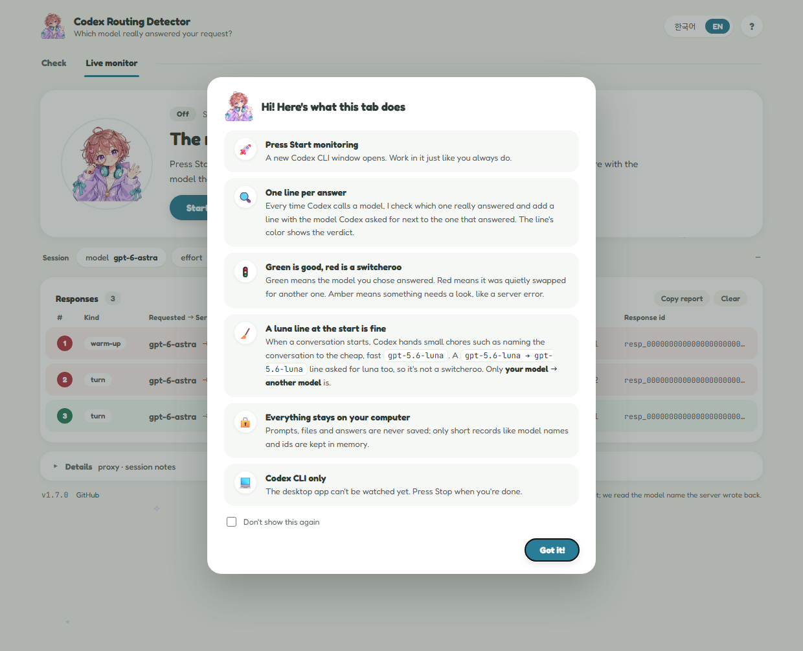

# Development

## Tests and build

```
python -m unittest discover -s tests -v   # parser, verdict and window tests; no real Codex call
build_exe.bat                             # builds dist\codex-routing-detector.exe (PyInstaller)
```

- `tests/test_parse.py` covers the frame parser and the verdicts. One test checks that a
  timed-out probe kills its whole process tree.
- `tests/test_webui.py` drives the window's logic without opening a window, through the data
  the page renders. `MascotPictures` also loads the real page in headless Edge to see which picture
  the verdict card shows (skipped without Edge).
- `tests/test_art.py` covers the green keying of the mascot art (skipped without numpy and Pillow,
  which only the art tools need).
- `tests/test_gui.py` and `tests/test_gui_live.py` build the fallback tkinter window off-screen
  and drive both tabs (skipped where tkinter has no display).
- `tests/test_live.py` runs the built-in proxy end to end against a local TLS WebSocket echo
  server (CONNECT, throw-away CA, masked and deflated frames) and checks the live aggregation.

The fixtures under `tests/fixtures` are two complete trace runs from 2026-09-22 with every id
replaced by a placeholder: an astra request served by luna, and a request that ended in
`server_is_overloaded`. `python codex_routing_webui.py --fake --auto-check` shows the window
with this fixture data instead of a live check, and `--fake --fake-live` fills the live tab with
sample rows. Both are for development only; the exe does not include the fixtures.

## Look and feel

The window follows the "Soft Sheet" design in `design_handoff_routing_detector_ui/`: one large
verdict card with the little hoodie detective in it, pill-shaped controls, an airy result list,
and a single teal accent on a sage-tinted background. pywebview (an embedded browser view)
draws it, while all the checking stays in Python. The page is loaded from a temporary file,
because it is larger than WebView2's limit for pages passed as a string.

The mascot pictures and three fonts are embedded in the program (`codex_routing_assets.py`,
`codex_routing_fonts.py`): Fredoka for latin text, NanumSquareRound for Korean and JetBrains
Mono for ids and times. The window therefore loads nothing from the network. All three fonts are
under the SIL Open Font License 1.1; their notices and the license text are in
`docs/FONT-LICENSES.txt`.

The verdict card shows the detective's mood: thumbs up for all good, a surprised point for a reroute,
tears when something needs a look, and the animated idle loop while idle or checking (the still
picture when Windows asks for reduced motion). The pictures were drawn with Codex CLI image
generation on a flat green background and the loop was made from the main picture with Grok's
`image_to_video`; `art/prompts/` holds the prompts. `tools/key_green.py` keys the green out (also
for every video frame, writing the looping WebP) into `art/source/`, and `tools/make_assets.py`
builds `codex_routing_assets.py` and `docs/icon.ico` from there, together with the copies the READMEs
and the design handoff show (`docs/mood-*.png`, `docs/mascot.png` for readers who prefer reduced
motion, `design_handoff_routing_detector_ui/assets/`). The READMEs show `art/source/mascot_anim.webp`
itself, so the animation is kept once. `tools/make_screenshots.py` renders
the `docs/screenshot*.png` images from `--fake` sample data with headless Edge. `docs/social-preview.png` is
the repository's social preview card (1280x640), rendered by `tools/make_social_preview.py` with
headless Edge; GitHub has no API for it, so it is uploaded by hand under Settings > General >
Social preview.

The window's words live in `codex_routing_webtext.py` (Korean and English). The fallback tkinter
window keeps its own strings in `codex_routing_detector_gui.py`.


