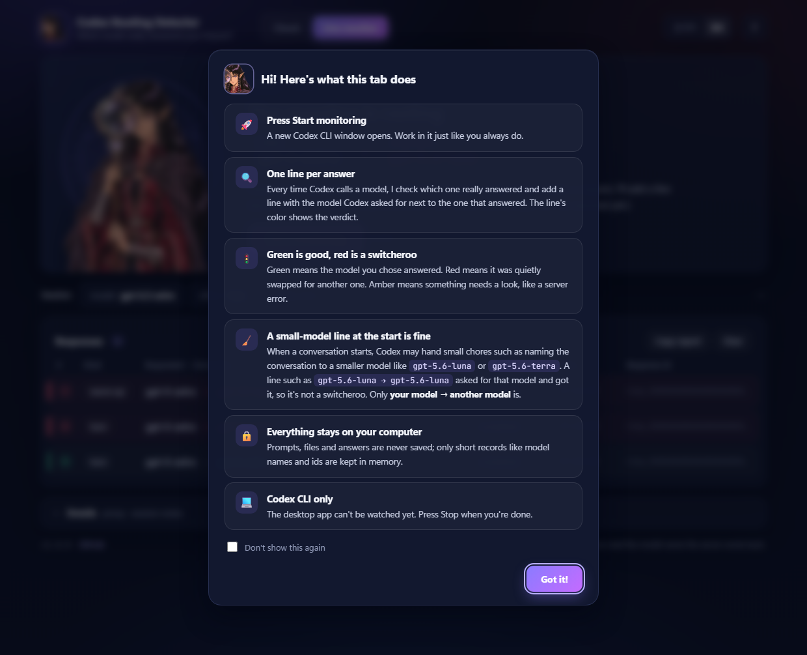

# Development

## Tests and build

```
python -m unittest discover -s tests -v   # parser, verdict and window tests; no real Codex call
build_exe.bat                             # builds dist\codex-routing-detector.exe (PyInstaller)
```

- `tests/test_parse.py` covers the frame parser and the verdicts. One test checks that a
  timed-out probe kills its whole process tree.
- `tests/test_webui.py` drives the window's logic without opening a window, through the data
  the page renders. `MascotPictures` also loads the real page in headless Edge to see which picture
  the verdict card shows (skipped without Edge).
- `tests/test_art.py` covers the green keying of the mascot art (skipped without numpy and Pillow,
  which only the art tools need).
- `tests/test_gui.py` and `tests/test_gui_live.py` build the fallback tkinter window off-screen
  and drive both tabs (skipped where tkinter has no display).
- `tests/test_live.py` runs the built-in proxy end to end against a local TLS WebSocket echo
  server (CONNECT, throw-away CA, masked and deflated frames) and checks the live aggregation.

The fixtures under `tests/fixtures` are two complete trace runs from 2026-09-22 with every id
replaced by a placeholder: an astra request served by luna, and a request that ended in
`server_is_overloaded`. `python codex_routing_webui.py --fake --auto-check` shows the window
with this fixture data instead of a live check, and `--fake --fake-live` fills the live tab with
sample rows. Both are for development only; the exe does not include the fixtures.

## Look and feel

The window follows the "Night Launcher" design, the look of a modern fantasy game launcher: a
deep navy night with two soft glows and a little drifting dust, frosted-glass panels with a thin
light edge, one violet accent, and plain high-contrast sans-serif text. The two tabs sit in the
top bar as a segmented control. The verdict card puts the half-elf seer large on its left, before
a glowing ring that takes the verdict's colour; on its right, under the headline, the model that
was called and the model that answered stand side by side as the biggest text on the card (the
first swapped answer, else the latest one). A reroute shakes the card, flashes it red and pops a
"!" beside her; an all-clear bursts small lights around her; while checking, the ring spins fast
and a striped bar fills. With Windows' animation effects turned off, all of this holds still. pywebview (an embedded browser view) draws it, while all
the checking stays in Python. The page is loaded from a temporary file, because it is larger than
WebView2's limit for pages passed as a string. The older "Soft Sheet" design is kept for reference
in `design_handoff_routing_detector_ui/`.

The mascot pictures and three fonts are embedded in the program (`codex_routing_assets.py`,
`codex_routing_fonts.py`): NanumSquareRound for Korean and JetBrains Mono for model names, ids
and times. Latin text uses Segoe UI, which every Windows install has. Fredoka is used only by the
social preview card. The window therefore loads nothing from the network. All three embedded fonts are
under the SIL Open Font License 1.1; their notices and the license text are in
`docs/FONT-LICENSES.txt`.

The verdict card shows the seer's mood: a calm smile for all good, a sharp point with her lens
blazing red for a reroute, a troubled frown when something needs a look, and the animated idle
loop while idle or checking (the still picture when Windows asks for reduced motion). The pictures were drawn with Codex CLI image
generation on a flat green background; `art/prompts/` holds the prompts. `tools/key_green.py` keys
the green out into `art/source/`, `tools/make_idle_loop.py` builds the looping WebP from the main
picture and an eyes-closed edit of it (see `art/README.md`), and `tools/make_assets.py`
builds `codex_routing_assets.py` and `docs/icon.ico` from there, together with the copies the READMEs
and the design handoff show (`docs/mood-*.png`, `docs/mascot.png` for readers who prefer reduced
motion, `design_handoff_routing_detector_ui/assets/`). The READMEs show `art/source/mascot_anim.webp`
itself, so the animation is kept once. `tools/make_screenshots.py` renders
the `docs/screenshot*.png` images from `--fake` sample data with headless Edge. `docs/social-preview.png` is
the repository's social preview card (1280x640), rendered by `tools/make_social_preview.py` with
headless Edge; GitHub has no API for it, so it is uploaded by hand under Settings > General >
Social preview.

The window's words live in `codex_routing_webtext.py` (Korean and English). The fallback tkinter
window keeps its own strings in `codex_routing_detector_gui.py`.


